<p align="center">
  
</p>

<p align="center">
  <a href="https://github.com/RemiPelloux/Containust/actions/workflows/ci.yml"></a>
  <a href="https://github.com/RemiPelloux/Containust/releases/latest"></a>
  
  
  <a href="LICENSE"></a>
</p>

<p align="center">
  <b><a href="#-quick-start">Quick start</a></b> ·
  <b><a href="#-use-cases">Use cases</a></b> ·
  <b><a href="#-plan--apply">Plan &amp; apply</a></b> ·
  <b><a href="#-how-it-works">How it works</a></b> ·
  <b><a href="site/docs/">Docs</a></b> ·
  <b><a href="roadmap.md">Roadmap</a></b>
</p>

---

**Containust** (`ctst`) is a daemon-less container runtime written in Rust. You
describe a stack in a small declarative `.ctst` file, `ctst plan` shows exactly
what will change, and `ctst run` applies it. There is no background service and
no root daemon socket. Every command reads and writes plain files in your
project, so state survives reboots, works offline, and can be copied to another
machine.

It runs natively on Linux with user + PID namespaces and cgroups v2, and in a
small QEMU micro-VM on macOS and Windows.

<p align="center">
  
</p>

## ✦ Why Containust

<table>
<tr>
<td width="33%" valign="top">

### No daemon
Each `ctst` command does its work and exits. There's no `dockerd` to keep
alive, secure, or restart. Project state lives in `.containust/` next to your
file, under atomic, file-locked writes.

</td>
<td width="33%" valign="top">

### Plan before apply
`ctst plan` diffs your file against what's running: `+` create, `~` replace,
`>` start, `=` keep, `-` remove. `ctst run` applies the same plan, is safe to
re-run, and can replace a service with zero dropped requests.

</td>
<td width="33%" valign="top">

### Air-gapped by design
`--offline` rejects the network before any connection opens. Images are
content-addressed and digest-pinned. Pull once, copy `.containust/`, then
run anywhere.

</td>
</tr>
<tr>
<td valign="top">

### Secure defaults
User + PID namespaces are on by default, all capabilities are dropped,
`no_new_privs` is set, and the rootfs is read-only. Archive extraction rejects
path escapes, and secrets are redacted in state.

</td>
<td valign="top">

### Real images, local-first
`file://` dirs, `tar://` archives, `preset://alpine`, or `ctst pull` from Docker
Hub or GHCR with auth and optional cosign provenance (`--require-provenance`).

</td>
<td valign="top">

### Embeddable
A Rust SDK exposes the parser, dependency graph, planner and runtime, so you can
drive containers from your own product without shelling out.

</td>
</tr>
</table>

## ◆ Use cases

<details open>
<summary><b>Air-gapped and sovereign sites</b>: defense, government, industrial OT, regulated labs</summary>

<br>

Pull and verify images on a connected machine, carry the content-addressed
store across the air gap, and run with the network policy enforced.

```bash
# connected side
ctst download stack.ctst --image postgres:16   # images, presets, VM assets if needed

# copy .containust/images and .containust/layers across the gap, then:
ctst --offline plan stack.ctst             # remote references fail closed
ctst --offline run -d stack.ctst
```

</details>

<details>
<summary><b>Local dev stacks without Docker Desktop</b>: no daemon, no licensing surprises, one binary</summary>

<br>

Describe the API, database and cache once. Components on the same network
reach each other by name, and `CONNECT` injects `*_HOST` / `*_PORT` env vars.
On macOS and Windows the same file runs in a QEMU micro-VM with port
forwarding.

```text
COMPONENT db  { image = "image://postgres@sha256:…"  port = 5432  network = "app" }
COMPONENT api { image = "file:///work/api/rootfs"     port = 8080  network = "app"  memory = "256MiB" }
CONNECT api -> db        // api reaches db at db:5432
EXPOSE 8080              // http://127.0.0.1:8080 on the host
```

Already on Compose? Run `ctst convert docker-compose.yml -o stack.ctst`.

</details>

<details>
<summary><b>CI environments and drift detection</b>: fail the build when reality diverges from the file</summary>

<br>

```bash
ctst plan --detailed-exitcode stack.ctst   # exit 2 if anything would change
ctst plan --json | jq '.changes[] | select(.action != "keep")'
```

Ephemeral test stacks start without Docker-in-Docker or a privileged socket
mount.

</details>

<details>
<summary><b>Edge boxes, appliances, kiosks</b>: small footprint, nothing idling in the background</summary>

<br>

One static binary plus files on disk. Restart policies and healthchecks are
enforced by reconciliation: every `ctst ps` or `ctst run` pass restarts failed
containers and probes health. A systemd timer gives you continuous supervision
without a resident daemon.

```ini
# /etc/systemd/system/ctst-reconcile.service
[Service]
Type=oneshot
WorkingDirectory=/srv/app
ExecStart=/usr/local/bin/ctst ps

# /etc/systemd/system/ctst-reconcile.timer   (systemctl enable --now ctst-reconcile.timer)
[Timer]
OnBootSec=30s
OnUnitActiveSec=30s

[Install]
WantedBy=timers.target
```

</details>

<details>
<summary><b>Reproducible demos, workshops and labs</b>: same digests, same result, any laptop</summary>

<br>

Ship a `.ctst` file with pinned digests and a pre-filled image store. Attendees
run `ctst run` with no registry account, no network, and no daemon setup.

</details>

<details>
<summary><b>Embedding containers in a Rust product</b>: SDK, not a subprocess</summary>

<br>

```rust
use containust_sdk::deploy::{ApplyOptions, Engine, EngineOptions};

let file = std::path::Path::new("stack.ctst");
let data_dir = containust_common::constants::project_dir(file);
let engine = Engine::with_options(EngineOptions {
    state_file: data_dir.join("state").join("state.json"),
    data_dir,
    offline: false,
});
println!("{}", engine.plan(file)?.summary());
let outcome = engine.apply(file, ApplyOptions { prune: true })?;
```

See [docs/SDK_GUIDE.md](docs/SDK_GUIDE.md).

</details>

## ⚡ Quick start

```bash
VERSION=1.4.0
TARGET=x86_64-unknown-linux-gnu   # or aarch64-unknown-linux-gnu, *-apple-darwin, x86_64-pc-windows-msvc
curl -LO "https://github.com/RemiPelloux/Containust/releases/download/v${VERSION}/ctst-${TARGET}.tar.gz"
curl -LO "https://github.com/RemiPelloux/Containust/releases/download/v${VERSION}/ctst-${TARGET}.tar.gz.sha256"
sha256sum -c "ctst-${TARGET}.tar.gz.sha256"
tar xzf "ctst-${TARGET}.tar.gz" && sudo install -m 755 ctst /usr/local/bin/ctst
```

<details>
<summary>Other install paths: .deb / .rpm, Homebrew, winget, from source</summary>

<br>

| Channel | Command |
| --- | --- |
| Debian / Ubuntu | `sudo dpkg -i ctst_1.4.0_amd64.deb` |
| Fedora / RHEL | `sudo rpm -i ctst-1.4.0-1.amd64.rpm` |
| Homebrew | `brew install --formula ./Formula/ctst.rb` |
| winget | manifest in [`packaging/winget/`](packaging/winget/) |
| Source | `cargo install --path crates/containust-cli` |

Releases ship a cosign-signed `SHA256SUMS`. See [docs/PACKAGING.md](docs/PACKAGING.md)
and [docs/RUNBOOKS.md](docs/RUNBOOKS.md) for verification. macOS and Windows need
**QEMU 7+**. Run `ctst doctor` to check your host.

</details>

A 60-second tour:

```bash
ctst doctor                                 # check backend, cgroups, cache, QEMU
ctst build examples/alpine_preset.ctst      # import preset://alpine into the project store
ctst run examples/alpine_preset.ctst        # prints "hello from preset://alpine"
```

Then, with your own long-running stack:

```bash
ctst pull postgres:16                       # OCI pull into the local catalog
ctst plan stack.ctst                        # what would change?
ctst run -d stack.ctst                      # apply it
ctst ps --all                               # reconcile + list (add --tui for a live dashboard)
ctst logs api --follow
ctst exec api uname -a
ctst run -d stack.ctst                      # re-run: everything is "keep", nothing restarts
ctst stop && ctst rm api db
```

## ⇄ Plan & apply

New in **1.3.0**: `ctst run` is declarative. Every component is fingerprinted
(image, command, env including `CONNECT` wiring, limits, volumes, ports,
network, restart policy, healthcheck, namespace policy), and the fingerprint
of what was last applied is stored in `.containust/state/applied.json`.

| Marker | Action | When | `ctst run` does |
| :---: | --- | --- | --- |
| `+` | create | no container with that name | create + start |
| `~` | replace | spec changed, or an upstream it `CONNECT`s to is being replaced | stop → remove → create → start, **one at a time in dependency order** |
| `>` | start | same spec, container stopped/failed | start |
| `=` | keep | same spec, running | nothing |
| `-` | remove | no longer declared | stop + remove, **only with `--prune`** |

```text
$ ctst plan stack.ctst
Plan for stack.ctst
────────────────────────────────────────────────
  ~ replace  db (spec changed)
      image: tar:///opt/images/pg16.tar
  ~ replace  api (upstream 'db' replaced)
  = keep     cache
  - remove   legacy (no longer declared)

  Plan: 0 to create, 2 to replace, 0 to start, 1 unchanged, 1 to remove.
  Removals apply only with `ctst run --prune`.
```

The ledger is written after each component. If an apply fails part-way, the
next run resumes from where it stopped.

New in **1.4.0**: zero-downtime updates. Give a component
`update = "start-first"` and a healthcheck, and `~ replace` stops being a
stop-then-start:

```text
  ~ replace  api (spec changed) [start-first]

  Creating container 'api~next'...          new version starts beside the old one
  Waiting for the new 'api' to become healthy...
  Traffic moved to the new 'api'; draining the old one for 5s...
                                             old one stops, api~next becomes api
```

The published port never closes: the forwarder switches its target in one
atomic step, so new connections reach the new container while open ones
finish on the old one. If the new version never becomes healthy it is
thrown away and the old one keeps serving, and a run that gets interrupted
is finished (or cleanly undone) by the next `ctst run`. A CI gate replaces a
live HTTP service under load and requires zero failed requests.

Start-first works on Linux for services published through the forwarder
(`network = "none"` or an `EXPOSE` remap) that are not part of a `CONNECT`;
everything else falls back to `recreate`, and `ctst plan` says why. Details in
[CTST_LANG.md §13](docs/CTST_LANG.md#13-update-strategy).

## ⌁ How it works

<p align="center">
  
</p>

1. **Parse & resolve.** A `nom` grammar reads `COMPONENT`, `CONNECT` and
   `EXPOSE`; `IMPORT`ed files and `FROM` chains are merged into each
   component. Unsupported properties, unreachable `CONNECT`s and remote
   images under `--offline` are reported before anything runs.
2. **Graph.** `petgraph` topologically sorts `CONNECT` edges. Cycles are
   rejected, and upstreams start first.
3. **Plan.** Desired fingerprints are diffed against live containers and the
   ledger.
4. **Apply.** On **Linux**, a pipe-synced fork/exec enters user, PID, mount,
   net, IPC and UTS namespaces, applies cgroups v2 limits, drops capabilities,
   and pivots into the rootfs. On **macOS and Windows**, the same requests go
   over a versioned JSON RPC to an agent inside a pinned Alpine QEMU VM.

The crates are layered `common → core → image → compose → runtime → sdk → cli`.
See [ARCHITECTURE.md](ARCHITECTURE.md).

## ⚖ Compared to Docker / Podman

| | Containust | Docker | Podman |
| --- | --- | --- | --- |
| Background daemon | **none** | `dockerd` (root) | none |
| Stack definition | `.ctst` (typed, validated) | Compose YAML | Compose / Kube YAML |
| Diff before apply | **`ctst plan`** | — | — |
| Zero-downtime replace | **`update = "start-first"`** (health-gated) | swarm services only | — |
| Enforced offline mode | **`--offline`, fail-closed** | — | — |
| Image store | content-addressed, per project, portable | global | global |
| Registry ecosystem | Hub + GHCR pull | full | full |
| Build from Dockerfile | — (import rootfs / tar / OCI) | ✓ | ✓ |
| Orchestration / swarm | — | swarm | pods |

Containust doesn't try to replace Docker everywhere. It targets places where
a daemon, a registry dependency, or opaque state is a liability.

## ▤ Commands

| Command | Purpose |
| --- | --- |
| `ctst plan [--json] [--detailed-exitcode]` | Diff desired vs running, read-only |
| `ctst run [-d] [--prune]` | Apply the plan |
| `ctst build [--dry-run]` | Import images into the project catalog |
| `ctst pull [--require-provenance]` | OCI pull (Hub, GHCR) into the catalog |
| `ctst download [--image] [--all-presets] [--vm]` | Prefetch everything for offline / on-prem use |
| `ctst ps [--all] [--tui]` | Reconcile, enforce restart and health, list |
| `ctst logs [-f]` · `ctst exec` | Inspect |
| `ctst stop [--force]` · `ctst rm` | Tear down |
| `ctst images` · `ctst convert` · `ctst doctor` · `ctst vm start/stop` | Catalog, Compose → `.ctst`, diagnostics, VM lifecycle |

Global flags: `--offline`, `--state-file`. Full reference:
[docs/CLI_REFERENCE.md](docs/CLI_REFERENCE.md).

## ⚙ Platforms & performance

| Host | Backend | Needs |
| --- | --- | --- |
| Linux 5.10+ (x86_64, aarch64) | Native namespaces + cgroups v2 | Root or delegated userns |
| macOS (Intel, Apple silicon) | QEMU micro-VM + agent | QEMU 7+, first-run VM assets |
| Windows x86_64 | QEMU micro-VM + agent | QEMU 7+, first-run VM assets |

CI enforces performance budgets on parse/resolve, image import, 10k-file
extraction and stop latency. Graceful stop returns as soon as the process
exits instead of after a fixed 2 s wait. `ctst pull` reuses layers already in
the store. See [docs/PERFORMANCE.md](docs/PERFORMANCE.md).

## ☰ Documentation

| | |
| --- | --- |
| [site/docs/](site/docs/) | HTML documentation (start here) |
| [docs/HowToUse.md](docs/HowToUse.md) | Operator guide: install, first run, ports, offline, troubleshooting |
| [docs/CTST_LANG.md](docs/CTST_LANG.md) | `.ctst` language reference |
| [docs/CLI_REFERENCE.md](docs/CLI_REFERENCE.md) | Every command and flag |
| [docs/MIGRATION_FROM_DOCKER.md](docs/MIGRATION_FROM_DOCKER.md) | Coming from Docker / Compose |
| [docs/THREAT_MODEL.md](docs/THREAT_MODEL.md) | Security model |
| [docs/README.md](docs/README.md) | Full documentation map |

## ⌨ Develop

```bash
cargo test --workspace --lib --tests
cargo fmt --all -- --check
cargo clippy --workspace --all-targets -- -D warnings
cargo deny check
python3 scripts/gen_readme_assets.py     # regenerate the animated README SVGs
```

See [docs/CONTRIBUTING.md](docs/CONTRIBUTING.md).

## License

Containust is proprietary and source-available under the
[Containust Commercial License](LICENSE). Evaluation use is allowed.
Production use, redistribution, and commercial embedding require a paid
license. See [COMMERCIAL.md](COMMERCIAL.md).
